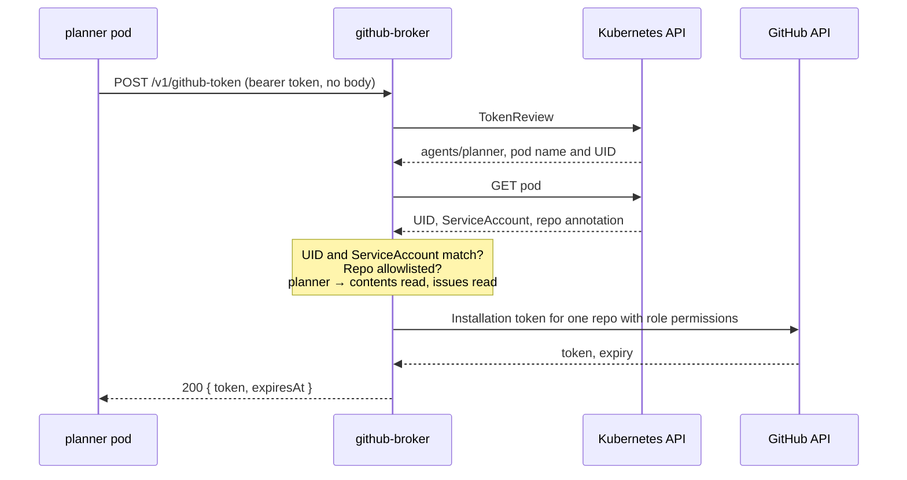

# GitHub token broker

[](https://qlty.sh/gh/flok-ai/projects/github-broker)
[](https://qlty.sh/gh/flok-ai/projects/github-broker)

Issues short-lived GitHub installation tokens to agent pods, scoped to one repository and the pod's role. Agent pods hold no PAT or other GitHub credential; only the broker holds the GitHub App key.

Standalone Fastify API, no UI. Deployed to AKS and [verified live](docs/live-verification.md) on 2026-11-18. API reference: <https://flok-ai.github.io/github-broker/>.

## How it fits

Platform design: [broker architecture](https://github.com/flok-ai/flok/blob/main/architecture/reference/token-broker.md). Current state and decisions: [docs/architecture.md](docs/architecture.md).

Kubernetes, not the pod, says who is calling. Pods annotated with the same repo get different access because they run as different ServiceAccounts:

```
                           Kubernetes API server
                     signs ServiceAccount tokens
                  │                                     │
                  │ projected token                     │ projected token
                  │ system:serviceaccount:              │ system:serviceaccount:
                  │   agents:planner                    │   agents:coder
                  │ aud: token-broker                   │ aud: token-broker
                  ▼                                     ▼
┌─ namespace: agents ───────────────────────────────────────────────────┐
│ ┌─ pod: planner-… ───────────────┐   ┌─ pod: coder-… ───────────────┐ │
│ │ serviceAccountName: planner    │   │ serviceAccountName: coder    │ │
│ │ ai-native-sdlc/repository:     │   │ ai-native-sdlc/repository:   │ │
│ │   owner/repo                   │   │   owner/repo                 │ │
│ └───────────────┬────────────────┘   └────────────────┬─────────────┘ │
└─────────────────┼─────────────────────────────────────┼───────────────┘
                  │ Bearer <planner token>              │ Bearer <coder token>
                  ▼                                     ▼
┌─ github-broker ───────────────────────────────────────────────────────┐
│        role from the ServiceAccount, never from the request           │
└─────────────────┬─────────────────────────────────────┬───────────────┘
                  ▼                                     ▼
        GitHub token: read                    GitHub token: write
        contents:read                         contents:write
        issues:read                           pull_requests:write
        owner/repo only                       issues:read
                                              owner/repo only
```

One token request:



The broker never caches tokens and never accepts scope from the caller.

## Using the broker

### Caller requirements

| Requirement | Value |
|---|---|
| Namespace | `agents` |
| ServiceAccount | `planner` or `coder`; anything else is denied |
| Token | Projected ServiceAccount token with audience `token-broker` |
| Pod annotation | `ai-native-sdlc/repository: owner/repo`, an exact match for a slug in the allowlist |

| ServiceAccount | Issued permissions |
|---|---|
| `planner` | `contents: read`, `issues: read` |
| `coder` | `contents: write`, `pull_requests: write`, `issues: read` |

### Request

From inside the cluster, at `http://github-broker.github-broker.svc.cluster.local`:

```sh
curl -X POST http://github-broker.github-broker.svc.cluster.local/v1/github-token \
  -H "Authorization: Bearer $(cat <projected-token-path>)"
```

The body must be absent or an empty JSON object (`{}`). Send no body without a JSON content type, or send `{}` as JSON; an empty body with `Content-Type: application/json` returns `400`. Any query string, extra body field, malformed body or unsupported content type returns `400`. Validation runs before Fastify's schema processing can strip properties or coerce input.

### Response

Success returns `200`, `Cache-Control: no-store`, and:

```json
{ "token": "<GitHub installation token>", "expiresAt": "2026-11-13T12:00:00Z" }
```

`expiresAt` comes from GitHub unchanged. Errors contain only `{ "error": { "code": "..." } }`:

| HTTP | Code | Condition |
|---|---|---|
| 400 | `invalid_request` | Query string, extra fields or malformed input |
| 401 | `invalid_credential` | Missing/malformed bearer, failed token review or wrong audience |
| 403 | `assignment_denied` | Unapproved namespace/ServiceAccount, pod identity mismatch or missing/malformed/unapproved repository annotation |
| 503 | `dependency_unavailable` | Token review, pod lookup, repo lookup or token issuer throws |

Upstream exceptions are neither logged nor included in responses. `GET /healthz` reports process liveness only; it does not check Kubernetes, GitHub or Key Vault readiness.

## Configuration and deployment

### Prerequisites

Infrastructure must provide:

- Namespace `github-broker` and ServiceAccount `token-broker` with workload identity.
- RBAC: cluster-wide `tokenreviews: create` (API group `authentication.k8s.io`) and core `pods: get` in namespace `agents`.
- ACR pull access.
- SecretProviderClass `github-broker-secrets` exposing `token-broker-gh-app-private-key`.

### Configuration

| Variable | Requirement / default |
|---|---|
| GH_APP_ID | Required numeric **App ID**, from the App's own settings page (Settings → Developer settings → GitHub Apps → the App → About). Not the installation ID and not the Client ID. |
| GH_APP_PRIVATE_KEY_PATH | Required readable RSA PEM file path |
| GH_REPOS_CONFIG_PATH | Path to a readable YAML repo allowlist. Defaults to `./repos.flok.yaml` relative to the working directory. |
| KUBERNETES_API_URL | HTTPS origin; defaults to `https://kubernetes.default.svc` |
| KUBERNETES_SERVICE_ACCOUNT_TOKEN_PATH | Defaults to `/var/run/secrets/kubernetes.io/serviceaccount/token` |
| NODE_EXTRA_CA_CERTS | Set before Node starts; in cluster, `/var/run/secrets/kubernetes.io/serviceaccount/ca.crt` |
| HOST / PORT | `127.0.0.1` / `3000`; container sets HOST to `0.0.0.0` |

[`repos.flok.yaml`](repos.flok.yaml) is a nonempty list. Each entry has a display `name`, a unique `owner/repo` slug, and positive safe integers for `repositoryId` and `installationId`. Get the repository ID with `gh api repos/<owner>/<repo> -q .id` and the installation ID from the end of the App's installation URL for the repo.

Invalid configuration exits before listening with fixed diagnostics that omit supplied values. Startup reads the App key and the allowlist before any GitHub or Kubernetes requests. Kubernetes token reads happen per request; the default ServiceAccount token automount must remain enabled. Node loads CA trust at process startup.

### Deploy

On pushes to `main`, after checks pass, CI publishes `<acr>.azurecr.io/github-broker:latest` and `sha-<full-commit>` from the production environment. It needs environment variable `AZURE_ACR_NAME` and secrets `AZURE_CLIENT_ID`, `AZURE_TENANT_ID` and `AZURE_SUBSCRIPTION_ID` for Azure OIDC, following platform-services.

```sh
cp manifests/.env.example manifests/.env
# Edit manifests/.env with real names and IDs (gitignored).
set -a
. manifests/.env
set +a
kubectl -n github-broker create configmap github-broker-repos --from-file=repos.flok.yaml --dry-run=client -o yaml | kubectl apply -f -
envsubst '$AZURE_ACR_NAME $GH_APP_ID' < manifests/deployment.yaml | kubectl apply -f -
kubectl apply -f manifests/service.yaml
kubectl -n github-broker rollout status deployment/github-broker
kubectl -n github-broker get pods
kubectl -n github-broker logs deployment/github-broker
```

After publishing a new `latest` image, run `kubectl -n github-broker rollout restart deployment/github-broker`. The readiness probe uses `/healthz`. To inspect it locally, run `kubectl -n github-broker port-forward service/github-broker 3000:80` and `curl http://127.0.0.1:3000/healthz`.

### Update the allowlist

For an existing deployment, edit `repos.flok.yaml` and run the following from the repository root. The target requires Bash, `kubectl`, and the local `manifests/.env` file.

```sh
kubectl config current-context
# Confirm this is the intended cluster before continuing.
make update-repos-config
```

The target sources `manifests/.env`, applies `repos.flok.yaml` to the `github-broker-repos` ConfigMap, restarts the broker, and waits up to 180 seconds for the rollout. The broker reads the read-only mount at `/app/repos.flok.yaml` once at startup, so the target requests a restart even when Kubernetes reports the ConfigMap as unchanged.

After rollout, confirm that a pod annotated with an allowlisted slug receives `200` from the token exchange and that an unlisted slug receives `403`. The target applies the local file, including any uncommitted edits. The planned database-backed lookup can replace the YAML lookup through the same async interface.

### Troubleshooting

The broker returns only error codes and logs no upstream causes, by design. A `503` after a successful token review can come from pod lookup or GitHub issuance with the YAML-backed allowlist. GitHub answers `404 Integration not found` when `GH_APP_ID` is not the App's ID, a `404` on the installation when `installationId` is wrong, and `422` when the App lacks a requested permission. To see GitHub's answer, call the GitHub API from the broker pod with the same App ID and key.

## Development

Node.js 24 LTS (`.node-version` and the package engine requirement select that release line), TypeScript ES modules and npm.

```sh
npm ci
npm run dev
```

The server listens on `127.0.0.1:3000`; set `HOST` and `PORT` to override. Running the server requires the [configuration](#configuration) above.

- `npm run dev`: run TypeScript with the `tsx` file watcher.
- `npm run build`: compile the service into `dist/`.
- `npm start`: run the compiled service; run the build first.
- `npm run lint`: ESLint and TypeScript recommended checks.
- `npm run typecheck`: check service and test types without emitting files.
- `npm test`: build the service, then run mocked endpoint tests and process tests for address configuration and SIGINT/SIGTERM shutdown.
- `npm test -- --coverage`: report V8 coverage of `src/` in the terminal and write `coverage/lcov.info`. Code exercised only by spawned server processes is outside the report.

Before a PR, run `npm run lint`, `npm run typecheck`, `npm test` and `npm run docs:build`. GitHub Actions verifies pull requests and pushes to `main`; after verification passes, a separate job uploads the LCOV report to Qlty using GitHub OIDC.

Build the image locally with `docker build -t github-broker:local .` and run it with `docker run --env-file <local-env-file> --mount type=bind,src=<absolute-key-file>,dst=/mnt/app.pem,readonly --mount type=bind,src="$(pwd)/repos.flok.yaml",dst=/app/repos.flok.yaml,readonly -e GH_APP_PRIVATE_KEY_PATH=/mnt/app.pem -p 3000:3000 github-broker:local`. The image uses the pinned platform-services Node 24 base, production dependencies and the non-root node user. The Docker context allows only build inputs.

### Code layout

- `src/app.ts`: `buildApp(fastifyOptions, tokenExchangeOptions)` constructs the application without opening a socket and registers the token endpoint when the second argument is supplied.
- `src/start-server.ts`: `startServer(env)` validates configuration, supplies the adapters and the YAML-backed lookup to `buildApp`, configures logging (Pino, authorization header redacted) and starts the listener using `HOST` and `PORT`.
- `src/server.ts`: the entrypoint; handles process errors and shutdown signals.
- `src/routes/v1/github-token.post.ts`: the endpoint and its policy. Directories and the `.post.ts` suffix describe the URL and method; the plugin is registered explicitly, without autoload.
- `src/token-exchange.types.ts`: `TokenExchangeOptions`, the injected dependencies:
  - `tokenValidator`: authentication/audience result and reviewed pod identity.
  - `podLookup`: UID, ServiceAccount and annotations for a namespace/pod name.
  - `tokenIssuer`: a scoped token and its expiry.
  - `repoLookup`: async lookup returning `{ repositoryId, installationId }` or `undefined` for an `owner/repo` name.
- `src/repos-config.ts`: the YAML-backed `repoLookup`.
- `src/kubernetes-adapters.ts`: `createKubernetesAdapters()` implements `TokenValidator` (TokenReview) and `PodLookup` with the broker's mounted ServiceAccount token, 30-second timeouts and rejected redirects. See the [Kubernetes adapter guide](docs-site/src/content/docs/kubernetes-adapters.md).
- `src/github-token-issuer.ts`: `createGitHubTokenIssuer()` implements `TokenIssuer` from `GH_APP_ID` and `GH_APP_PRIVATE_KEY_PATH`, sending exactly one `repository_ids` entry and the role's `permissions` per request. See the [issuer guide](docs-site/src/content/docs/github-issuer.md).

Local imports use `.js` extensions. Use relative imports for sibling files and `#src/…` for source modules in other directories. The package import map selects TypeScript source under the development condition and compiled JavaScript by default. The build emits service code only; Vitest handles the TypeScript test files.

### Tests

Tests generate disposable RSA keys and use no real credentials or network dependencies. `test/routes/v1/github-token.post.test.ts` uses Fastify `inject()` and mocked dependencies to verify the contract, exact issuance scope, call order, authorization denials and sanitized dependency failures. The `test/app.test.ts` process tests require permission to bind a loopback socket. Live checks against the cluster are recorded in [docs/live-verification.md](docs/live-verification.md).

### API reference site

```sh
npm ci
npm ci --prefix docs-site
npm run docs:build
npm run docs:dev
```

`docs:build` generates the ignored `docs-site/openapi.json` from the Fastify route schemas with stub dependencies, then builds the Starlight site into `docs-site/dist/`. `docs:dev` regenerates the spec and starts Astro at <http://localhost:4000/github-broker/>; restart it after route-schema changes. Generation needs no network, cluster, GitHub key or token. Swagger is a development dependency of the generation script only; the running broker exposes no docs or OpenAPI route.

Route schemas must have `summary` and `description`; keep tags, request/response schemas and examples aligned with behavior. The docs workflow builds on pull requests and deploys on pushes to `main` or manual dispatch on `main`. See [docs-site/README.md](docs-site/README.md) for generation details.

## License

[flok](https://github.com/flok-ai) GitHub token broker is licensed under the [GNU Affero General Public License v3.0 only](./LICENSE) (AGPL-3.0-only). Copies, modified versions and network deployments must keep the attribution described in [NOTICE](./NOTICE).

Versions up to and including v0.1.0 were released under the MIT License.
